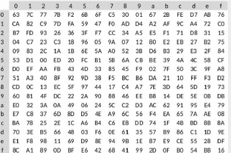
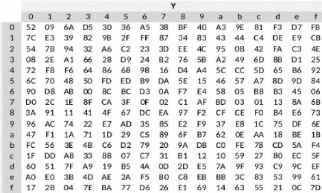

# Assignment and rubric

This is a structured transcription of the supplied **Project+Rurbric.docx**, reviewed during this project on 17 November 2026. The original DOCX could not be found at its earlier Downloads location when the public repository was prepared. This file preserves its requirements and marking criteria; it is not an original university-issued DOCX. The two example S-box figures below were extracted from that original document.

## Course and submission information

| Field | Handout information |
| --- | --- |
| Department | Computer Science and Information Technology |
| Course | Introduction to Cryptography, CSE 310 |
| Semester | Fall 2026/2027 |
| Activity | Project |
| Title | A New Symmetric Algorithm |
| Weight | 15% |
| Group | Two students |
| Deadline | Monday 23 November 2026 at 23:59 |
| Submission channel | Blackboard |
| Late penalty | Minus 0.5 per day |
| Other channels | Email and MS Teams submissions are not accepted. |

## Algorithm requirements

The handout introduces symmetric encryption with a shared secret key, repeated block operations, substitution, permutation and CBC chaining. Its proposed algorithm specifies:

1. Use four rounds for each block.
2. Use 16-bit blocks and 16-bit subkeys.
3. Use a 16-bit secret key and generate four 16-bit subkeys using an AES method.
4. Use substitution and permutation operations. Create S-boxes and their inverses.
5. Use the four bit-shuffling patterns shown below.
6. Create a pool of ten S-boxes with different values. Select two for each round based on the subkey. The handout permits manual S-box generation or an automated tool.
7. Split each 16-bit block into two 8-bit halves. For each half, the first four bits select the S-box row and the second four bits select its column. The selected result is eight bits.
8. Select the first S-box by interpreting the subkey normally and taking modulo 10. Select the second by interpreting the same 16 bits in the opposite direction and taking modulo 10. The handout example interprets `0000000000000011` as 3 in one direction and 49152 in the other.
9. Apply substitution, permutation and XOR with the subkey in each round.

The handout also contains the wording “4x4 bits to generate 8 bits.” Its later, detailed row/column description uses four row-index bits and four column-index bits. The implementation follows that detailed description and uses 256-entry, 16 by 16 byte tables. The chosen convention is explained in [design decisions](../docs/DESIGN_DECISIONS.md).

## Supplied bit patterns

The first row is positions 1 through 16. The second row is the supplied pattern. The implementation's direction convention is documented separately rather than attributed to an explicit instruction in the handout.

| Position | 1 | 2 | 3 | 4 | 5 | 6 | 7 | 8 | 9 | 10 | 11 | 12 | 13 | 14 | 15 | 16 |
| --- | --- | --- | --- | --- | --- | --- | --- | --- | --- | --- | --- | --- | --- | --- | --- | --- |
| Pattern 1 | 6 | 8 | 1 | 2 | 4 | 3 | 5 | 7 | 12 | 16 | 9 | 10 | 14 | 15 | 13 | 11 |
| Pattern 2 | 9 | 10 | 1 | 3 | 5 | 7 | 11 | 13 | 2 | 4 | 6 | 8 | 12 | 14 | 15 | 16 |
| Pattern 3 | 3 | 5 | 7 | 9 | 11 | 13 | 15 | 1 | 2 | 4 | 6 | 8 | 10 | 12 | 14 | 16 |
| Pattern 4 | 16 | 15 | 14 | 13 | 12 | 11 | 10 | 9 | 8 | 7 | 6 | 5 | 4 | 3 | 2 | 1 |

## Example S-box figures supplied in the handout

These are the handout's example figures, labeled S-box and inverse S-box. The program generates its own pool of ten permutations, as requested; these example figures are not presented as the program's generated tables.

## Required work and marks

| Requirement | Marks | Current evidence |
| --- | ---: | --- |
| Design a flowchart covering the algorithm. | 1 | Report Section 1, page 1; [flowchart image](../report/flowchart.png). |
| Write pseudocode for the proposed algorithm. | 2 | Report Section 2, page 2. |
| Manually trace a 16-bit plaintext and 16-bit key. | 2 | Report Section 3, page 3; key expansion also appears on page 2. |
| Develop encryption code in any language; generate ciphertext automatically. Plaintext is the ADU ID of each group member. | 4 | [symmetric_cipher.py](../symmetric_cipher.py); report Section 4, page 4; both IDs in [results](../results/results.json). |
| Test diffusion and confusion by changing one plaintext bit and one key bit. | 2 | Report Section 5, page 5; the demo and result records contain both tests. |
| Presentation. | 4 | Nine-slide [PowerPoint](../presentation/Symmetric_Algorithm_Presentation.pptx) and [speaker notes](../presentation/SLIDES_AND_NOTES.md). Actual delivery remains a student task. |
| **Total** | **15** | |

## Detailed marking descriptions

The supplied rubric labels its performance levels Excellent (100% of the criterion), Good (50%) and Poor (25%). The following preserves the substance of each descriptor in concise wording.

| Criterion | Excellent | Good | Poor |
| --- | --- | --- | --- |
| Flowchart, 1 mark | Clear logical flow covering key expansion, substitution, permutation and XOR. | Minor steps missing or connections unclear. | Incomplete or unrelated flowchart. |
| Pseudocode, 2 marks | Accurate, well-structured steps covering all rounds and operations. | Some steps unclear or out of order; still understandable overall. | Major errors or missing steps. |
| Manual trace, 2 marks | Correct step-by-step S-box, permutation and subkey XOR calculations. | Some calculation or logical errors; generally correct trace. | Missing trace or incorrect method. |
| Encryption implementation, 4 marks | Functional, efficient implementation of key generation, substitution, permutation, XOR and multiple rounds. | Works with minor issues or omissions. | Incomplete, nonfunctional or incorrect code. |
| Diffusion/confusion tests, 2 marks | Tests one-bit changes to both plaintext and key with clear results and explanation, such as the avalanche effect. | Tests only plaintext or key, or analysis is unclear. | Missing tests or incorrect method. |
| Presentation, 4 marks | Clear, structured and confident; both students participate and explain the algorithm, steps and results using suitable terminology. | Understandable but has some clarity, structure or delivery issues. | Unclear or unorganized, missing major explanations, or minimal participation. |

The implementation choices that go beyond explicit instructions, including the two-call key schedule, fixed seed, numeric ID formatting and leading-zero padding and demonstration IV, are recorded in [design decisions](../docs/DESIGN_DECISIONS.md). This map records evidence locations rather than claiming a grade or instructor approval.
